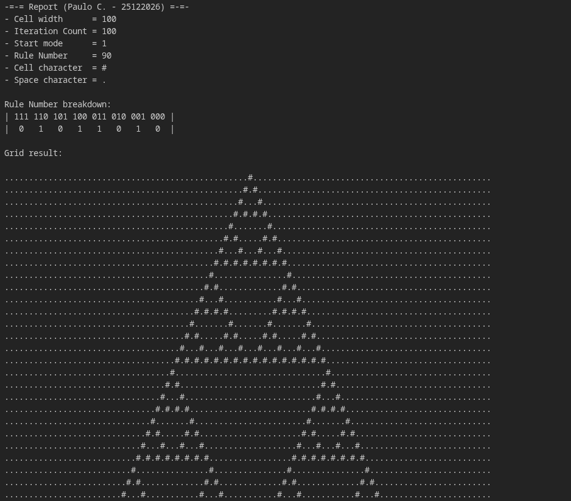

# ECA - Elementary Celullar Automaton

> An elementary cellular automaton (1D) written in C99. This is my submission for my Complex Systems class. I additionally implemented command-line parameters to configure the cell width, grid size, and other options.

## Downloading
This project contains no dependencies, so its safe to clone it directly:

```bash
git clone https://github.com/dat-alpaca/kit-eca
```

## Requirements:
If you use CMake to compile the project, you need, obviously, CMake:
- [Download CMake](https://cmake.org/download/)

You are also going to need a `C99 compiler`. This should come installed in most operating systems, but in case you don't have it in your machine, feel free to pick the easiest option for you:

- [Download GCC](https://gcc.gnu.org/install/download.html)
- [Download Clang](https://releases.llvm.org/download.html)
- [Download MSVC Build Tools](https://learn.microsoft.com/en-us/cpp/overview/acquire-msvc?view=msvc-170)

## Building
This project is tiny. As long as you compile and link all the translation units with the standard library, you should be able to get a working copy.

### Building on UNIX:
If you are using a UNIX-based operating system, you may use the files provided in the `scripts` folder.

You can choose between building with your user environment gcc compiler:

```bash
./scripts/run_gcc_linux.sh
```

Or using CMake:
```bash
./scripts/run_cmake.sh
```

### Building on other OSes:
If you are using another operating system (perhaps you are a Win32 developer, in which case I'm sorry for you), you will have to use CMake yourself, since the script files are not going to work. However, this process is simple:

```bash
# Configure
cmake -B build

# Compile
cmake --build build
```

## Running:
The output of both the default linux-gcc script and the cmake file is `bin/main`. 
The program utilizes command-line arguments to determine the state of your application. If you just want to run it using the default parameters, don't specify arguments. It will figure it out.

An example with all possible command-line arguments you can play around with:

```bash
./bin/main --cell_width=100 --iterations=100 --rule=90 --start_mode=1 --cell='#' --space='.'
```

<br>

### Example result:


## License:
This project is licensed under the [Unlicensed license](https://unlicense.org) - see the [LICENSE](LICENSE) file for details. 